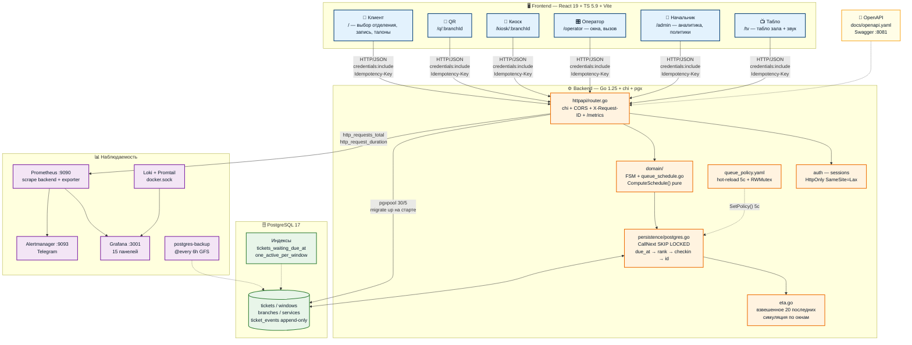
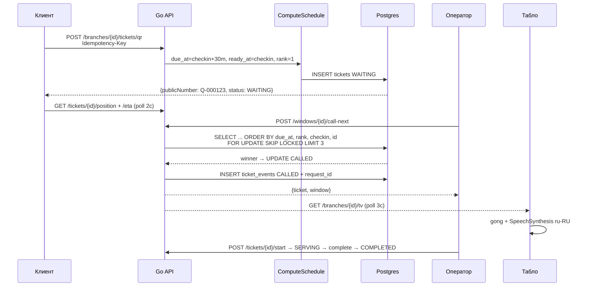

<div align="center">

# 📮 Цифровая очередь нового поколения

**Меньше неопределённости. Больше времени для людей.**

Клиент · Оператор · Начальник отделения · Табло зала


[Быстрый запуск](#запуск) · [Возможности](#сценарии-проекта) · [API](docs/openapi.yaml) · [Проверки](#проверки)

</div>

---

Электронная очередь для отделения Почты России: талоны через QR и терминал,
предварительная запись, управление окнами и наблюдаемость. React 19 + TypeScript
на клиенте, Go + PostgreSQL на сервере.

## Сценарии проекта

| Роль / экран | Реализовано |
|---|---|
| Клиент `/` | Выбор отделения и услуги, запись на время, талоны и их статусы, отмена |
| QR `/q/:branchId` | Страница выбранного отделения, получение талона после подтверждения |
| Терминал `/kiosk/:branchId` | Интерфейс в зале, полный экран, сброс после бездействия |
| Оператор `/operator` | Выбор окна, вызов, повторный вызов, обслуживание, завершение и перенаправление |
| Начальник `/admin` | Live-очередь, окна, расписание, политики, пользователи и показатели |
| Табло `/tv?branchId=…` | Номер талона → окно, ожидающие, голосовые объявления, московское время |

Это перечень возможностей в коде, а не заявление о формальной приёмке всех пунктов ТЗ.
Документы предметной области: [Sprint 1](docs/sprint1-domain.md),
[Sprint 2](docs/sprint2-domain.md), [Sprint 3](docs/sprint3-domain.md).
Контракт API: [OpenAPI](docs/openapi.yaml).

## Что получилось особенно хорошо

- **Общий источник данных:** PostgreSQL хранит талоны, состояние окон и события;
  табло не подставляет демонстрационные номера при пустой очереди или ошибке.
- **Детерминированный вызов:** порядок определён сроком обслуживания и стабильными
  правилами разрешения равенств. Конкурентный выбор использует блокировки PostgreSQL.
- **Понятные действия:** номер талона и окно — главные элементы табло; для начальника
  есть светлый live-экран и таблица с поиском/фильтрацией.
- **Доступность:** масштаб шрифта, высокий контраст, клавиатурный фокус,
  обозначенные выбранные кнопки, настройка звука и уменьшение анимации.
- **QR-плакат без рекламных обещаний:** только ссылка на отделение и инструкция.
- **Время без сюрпризов:** ввод и отображение записи в московском часовом поясе,
  независимо от часового пояса браузера.

## Как рассчитывается очередь

### Путь посетителя

```text
QR / терминал / сайт → Отделение и услуга → Талон или запись
                                                  ↓
                            Позиция и оценка ожидания
                                                  ↓
                          Вызов на табло → Обслуживание
```

### Удобство на каждом экране

- **На телефоне:** быстрый выбор даты и времени, время справа от даты,
  адаптивный блок ожидания без разрывов слов.
- **В кабинете начальника:** серверная пагинация пользователей и аномалий —
  10, 25 или 50 записей, по умолчанию 25; размер страницы рядом с диапазоном записей.
- **У оператора:** первые 25 талонов очереди вместо загрузки всего списка;
  обновление списка по мере работы с талонами.
- **В зале:** светлое табло, крупные номера и голосовой вызов;
  озвучивание сосредоточено на экране ТВ.

### Срок обслуживания и готовность к вызову

Реализация: `backend/internal/domain/queue_schedule.go`,
`backend/internal/persistence/postgres.go`. Настройки: [queue_policy.yaml](queue_policy.yaml).

Для QR и живой очереди:

```text
ready_at = checkin_at
due_at   = checkin_at + max_wait_minutes
```

Для записи при прибытии в допустимое окно опоздания:

```text
due_at   = scheduled_at
ready_at = max(checkin_at, scheduled_at - early_window_minutes)
```

При опоздании за пределы grace-периода применяется срок живой очереди.
Талон допускается к вызову только при совместимости услуги с окном и наступившем
`ready_at`. Порядок выбора:

```text
due_at ASC → source_rank ASC → checkin_at ASC → id ASC
```

Срок — ориентир планирования, **не гарантия отсутствия ожидания**.
В коде также сохранён legacy-расчёт эффективного приоритета для диагностики/аудита;
его не следует путать с основным порядком `CallNext`.

### Прогноз ожидания (ETA)

Реализация: `backend/internal/persistence/eta.go`.
Берутся до 20 последних завершённых обслуживаний той же услуги в отделении.
Новые измерения имеют больший вес (`i = 0` — самое свежее):

```text
duration = Σ(durationᵢ × (N − i)) / Σ(N − i)
```

Если измерений меньше трёх, используется 300 секунд. Для свободного окна время
доступности равно нулю; для занятого — `max(30, duration − elapsed)` секунд.
Каждый предшествующий талон распределяется на окно с ближайшим освобождением.
Прогноз для клиента — минимальное время доступности после распределения,
ограниченное диапазоном 60–1800 секунд. Это оценка, а не обещанное время приёма.
При отсутствии совместимых окон применяется резервная оценка из реализации.

## Запуск

Нужны Docker Engine/Desktop и Compose v2.

```bash
cp .env.example .env
# Задайте собственные пароли и публичный URL в .env
docker compose up --build -d
docker compose ps
```

| Сервис | Адрес по умолчанию |
|---|---|
| Приложение | http://localhost:5173 |
| Swagger UI | http://localhost:8081 |
| API health / readiness | http://localhost:8080/health · /ready |
| Grafana | http://localhost:3001 |

Для QR на телефонах укажите `PUBLIC_APP_BASE_URL`, доступный посетителям:
`localhost` телефона не ведёт на компьютер с приложением.
Vite проксирует `/api` в backend внутри Compose-сети. Не задавайте Docker hostname
как публичный URL браузера. `.env` и учётные данные не коммитятся.

PostgreSQL при первом запуске инициализируется через `postgres/init.sql`.
Существующий volume не переинициализируется: изменения схемы требуют осознанного
обновления с резервной копией. `docker compose down` сохраняет данные;
**`docker compose down -v` удаляет их**.

## Проверки

Для локальных проверок нужны Go 1.25+ и Node 22.12+:

```bash
cd frontend
npm ci
npm test
npm run build
cd ../backend
go test ./...
go vet ./...
```

Browser smoke-тесты: `qa/sprint4/browser.mjs` (живой backend и тестовые учётные
данные `QA_OPERATOR_PASSWORD`/другие переменные сценария),
`qa/sprint4/visual-regression.mjs` (цвета, доступность, однострочный номер ТВ).
Playwright можно установить вне репозитория:

```bash
npm install --prefix /tmp/sprint4-browser playwright
CHROMIUM_PATH=/usr/bin/google-chrome node qa/sprint4/visual-regression.mjs
```

Тест визуальных состояний использует контролируемый ответ API для ТВ; это не замена
проверке полного операторского цикла. Скриншоты сохраняются в `/tmp/queue-*.png`.

## Структура

### Архитектура — интерактивная схема

> Наведите на узел, кликните по цвету. Разверните детали ▼ под схемой.



<details>
<summary><b>🔍 Как читать схему — кликни чтобы развернуть</b></summary>

| Цвет | Слой | Что внутри | Ключевой файл |
|---|---|---|---|
| <span style="color:#003B73">■</span> Синий | Frontend | Клиент / QR / Киоск / Оператор / Начальник / Табло — polling 2–5с, Moscow TZ, a11y | `frontend/src/App.tsx:14`, `features/client/`, `operator/`, `admin/`, `TVBoard.tsx` |
| <span style="color:#ED6C02">■</span> Оранжевый | Backend | `chi` роутер, сессии, чистая `domain`, `SKIP LOCKED` вызов, ETA-симуляция, hot-reload политики | `backend/cmd/api/main.go:52`, `internal/domain/queue_schedule.go:133`, `persistence/postgres.go:375` |
| <span style="color:#2E7D32">■</span> Зелёный | Данные | Postgres 17, `tickets`+`windows`+`events` append-only, индексы `due_at`, бэкапы GFS | `postgres/init.sql`, `migrations/000014`, `docker-compose.yml:219` |
| <span style="color:#7B1FA2">■</span> Фиолетовый | Наблюдаемость | Prometheus → Grafana (15 панелей) → Alertmanager (Telegram), Loki+Promtail | `monitoring/prometheus.yml`, `grafana/.../overview.json` |

</details>

<details>
<summary><b>🔄 Жизненный цикл талона (последовательно)</b></summary>



*Запись:* `due_at=scheduled_at`, `ready_at=max(checkin, scheduled-early_window)`; опоздание `> grace 15м` → `due_at=checkin+30m, rank=live` — клиент не теряется.

</details>

<details>
<summary><b>📁 Карта репозитория</b></summary>

```text
backend/                Go API, домен, persistence, тесты
  cmd/api/main.go         точка входа, automigrate, hot-reload, graceful shutdown
  internal/domain/        FSM, queue_schedule.go, models, ETA
  internal/persistence/   postgres.go (CallNext), eta.go, admin.go, users.go
  migrations/000001-14    схема + сиды (Демо №1, admin/operator)
frontend/               React 19 + TS 5.9 + Vite 7
  src/App.tsx             ручной роутер (pushState), health-check, kiosk-mode
  src/features/client/    запись, талоны, workload, TV
  src/features/operator/  вызов/возврат/редирект, очередь 25
  src/features/admin/     live-очередь, KPI, политика, расписание, юзеры
  src/utils/time.ts       Europe/Moscow, workload.ts, postalVoice.ts
postgres/init.sql       init для первого volume (далее — golang-migrate)
docs/openapi.yaml       контракт API (1821 строка, Swagger :8081)
qa/sprint{1,2,3}/       чёрный ящик HTTP-тесты + sprint4 smoke
monitoring/             prometheus.yml, alerts.yml, loki, grafana dashboards
scripts/                validate_env.sh, autopull.sh, load_test.js (k6)
queue_policy.yaml       appointment grace 15 / early 10 / sources rank / call 90s×2
docker-compose.yml      12 сервисов, healthchecks, volumes, resource limits
```

</details>

### Документация

| Материал | Содержание |
|---|---|
| [OpenAPI](docs/openapi.yaml) | Контракт HTTP API |
| [Sprint 1](docs/sprint1-domain.md) | Основы предметной модели |
| [Sprint 2](docs/sprint2-domain.md) | Развитие доменных сценариев |
| [Sprint 3](docs/sprint3-domain.md) | Следующий этап реализации |
| [Политика очереди](queue_policy.yaml) | Настройки планирования |

## Ограничения и эксплуатация

- Голос зависит от доступных голосов ОС и политики автозапуска браузера.
- Прогноз загрузки не равен гарантии приёма; ETA зависит от истории и состояния окон.
- Frontend пока загружает Tailwind через CDN: нужен сетевой доступ к нему.
- Сборка предупреждает о JS-бандле больше 500 kB; дальнейшая оптимизация — разбиение по маршрутам.
- Для диагностики: `docker compose logs --tail=100 backend frontend postgres`.
  `/health` проверяет процесс, `/ready` — доступность БД.
- Если Docker Desktop показывает старый frontend: `docker compose restart frontend`
  и обновление страницы без кэша.