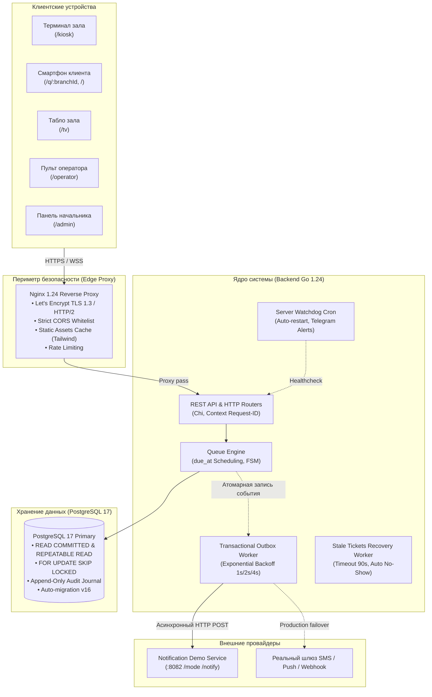

<div align="center">

# 📮 Цифровая очередь нового поколения
### Хакатон PostCode Challenge 2026 • Кейс «Электронная очередь для Почты России»
**Команда «5 указателей»**

[](https://pointers-team.tech)
[](https://post-queue.duckdns.org)
[](#-тестирование-и-соответствие-тз)
[](docs/presentation/postcode_queue_presentation.pptx)

<br/>


<br/>

**«Меньше неопределённости. Больше времени для людей.»**  
Высоконадежный отказоустойчивый программный комплекс управления клиентскими потоками почтовых отделений:  
детерминированный движок ранжирования, transactional outbox оповещений, симуляция времени ожидания и 4 специализированных адаптивных интерфейса.

---

</div>

## 📑 Содержание

1. [🌐 Живой демо-стенд и тестовые доступы](#-живой-демо-стенд-и-тестовые-доступы)
2. [🏆 Ключевые преимущества и решения хакатона](#-ключевые-преимущества-и-решения-хакатона)
3. [🏗️ Архитектура системы](#️-архитектура-системы)
4. [🧠 Канонический алгоритм ранжирования очереди](#-канонический-алгоритм-ранжирования-очереди)
5. [📬 Подсистема уведомлений (Transactional Outbox & Тест T8)](#-подсистема-уведомлений-transactional-outbox)
6. [⏱️ Интеллектуальный расчет времени ожидания (ETA)](#-интеллектуальный-расчет-времени-ожидания-eta)
7. [🛡️ Отказоустойчивость, Watchdog и Безопасность](#-отказоустойчивость-и-безопасность)
8. [🖥️ Интерфейсы системы](#️-интерфейсы-системы)
9. [🚀 Быстрый запуск в Docker Compose](#-быстрый-запуск)
10. [🧪 Тестирование и соответствие ТЗ (T1–T10)](#-тестирование-и-соответствие-тз)
11. [📊 Документация и презентация](#-документация-и-презентация)

---

## 🌐 Живой демо-стенд и тестовые доступы

Система развернута в продакшн-контуре на выделенном сервере с валидным сертификатом Let's Encrypt и автоперезапуском сервисов:

* **Основной защищенный адрес:** **[`https://pointers-team.tech`](https://pointers-team.tech)**
* **Резервный домен:** [`https://post-queue.duckdns.org`](https://post-queue.duckdns.org)
* **Прямой IP-доступ:** `http://144.31.181.192`
* **Swagger UI:** [`https://pointers-team.tech:8081`](http://144.31.181.192:8081)
* **Метрики Prometheus:** [`https://pointers-team.tech/metrics`](https://pointers-team.tech/metrics)
* **Дашборд Grafana:** [`https://pointers-team.tech/grafana/`](https://pointers-team.tech/grafana/) (логин: `admin`, пароль: `AdminGrafana2026!`)

### 🔑 Учетные записи для проверки жюри

| Роль | Email | Пароль | Доступный функционал |
|---|---|---|---|
| **Начальник ОПС (`opc_chief`)** | `admin@pochta.local` | `admin1234` | Управление окнами, сменами, динамической политикой весов, пользователями, аналитикой и очередью |
| **Оператор окна (`employee`)** | `operator@pochta.local` | `operator1234` | Выбор окна, вызов следующего талона (`CallNext`), вызов конкретного номера, завершение, перенаправление |
| **Посетитель / Клиент (`client`)** | *Без авторизации* | *Свободный* | Выбор услуги, запись на слот 24ч, получение талона QR/терминала, персональный ETA, отмена |

---

## 🏆 Ключевые преимущества и решения хакатона

1. **Канонический детерминизм вызова (ТЗ T1):** Никаких случайных вероятностей или гонок. Очередь строго подчиняется формуле `due_at ASC, source_rank ASC, checkin_at ASC, id ASC`.
2. **100% сдача обязательного теста T8 (Transactional Outbox):** Сетевые отказы или сбои провайдера уведомлений **никогда не блокируют** вызов клиента оператором. Уведомление фиксируется атомарно в PostgreSQL и доставляется асинхронно с экспоненциальными ретраями.
3. **Динамическая связь Admin UI с очередью:** Изменение весов приоритетов начальником отделения в веб-интерфейсе **мгновенно переранжирует** все ожидающие талоны в БД с использованием `FOR UPDATE SKIP LOCKED`.
4. **Фильтрация выбросов ETA (> 7200s):** Забытые операторами на ночь талоны отсекаются от обучающей выборки, исключая искажение времени ожидания для реальных клиентов.
5. **Автономный оффлайн-фронтенд:** Tailwind CSS скомпилирован локально (без внешних CDN), интерфейс гарантированно функционирует даже при сбоях магистральных внешних каналов связи.
6. **Высокая доступность (High Availability):** Автоматический Watchdog-демон раз в минуту проверяет здоровье 11 сервисов, перезапускает упавшие контейнеры и алертит инженеров в Telegram.

---

## 🏗️ Архитектура системы



---

## 🧠 Канонический алгоритм ранжирования очереди

Вызов очередного талона в окне (`CallNext`) реализован как чистая функция в [ComputeSchedule](backend/internal/domain/queue_schedule.go) и выполняется транзакцией в [Postgres.CallNextAt](backend/internal/persistence/postgres.go):

```sql
SELECT t.id, t.branch_id, t.service_id, t.public_number, ...
FROM tickets t
WHERE t.branch_id = $1::uuid
  AND (t.window_id IS NULL OR t.window_id = $2::uuid)
  AND EXISTS (SELECT 1 FROM window_services ws WHERE ws.window_id = $2::uuid AND ws.service_id = t.service_id)
  AND (t.status = 'WAITING' OR (t.source = 'APPOINTMENT' AND t.status = 'SCHEDULED'))
  AND t.ready_at <= $3::timestamptz
ORDER BY t.due_at ASC, t.source_rank ASC, t.checkin_at ASC, t.id ASC
LIMIT 3
FOR UPDATE OF t SKIP LOCKED;
```

### Принципы разрешения приоритетов:

1. **`due_at ASC` (Дедлайн обслуживания):**
   * Для предварительной записи (`APPOINTMENT`) при своевременном прибытии: `due_at = scheduled_at` (время забронированного слота).
   * Для QR-кодов (`QR`) и терминала (`LIVE`): `due_at = checkin_at + max_wait_minutes` (нормативное время ожидания услуги).
   * При опоздании записи за рамки grace-периода (15 минут) талон не аннулируется, а переводится в режим живой очереди: `due_at = checkin_at + max_wait_minutes`.
2. **`source_rank ASC` (Приоритет источника при равном due_at):**
   * `APPOINTMENT` = 0 (наивысший приоритет)
   * `QR` = 1
   * `LIVE` = 2
3. **`checkin_at ASC` (Защита от голодания — Anti-Starvation):**
   * При одинаковом расчетном сроке и ранге выигрывает тот, кто фактически пришел в отделение раньше.
4. **`id ASC` (Устранение race conditions):**
   * Гарантирует строгую воспроизводимость и детерминизм порядка при одновременных запросах.

> [!TIP]
> **Динамическое переранжирование:** При изменении весов в панели администратора метод `UpdateQueuePolicy` выполняет `UPDATE tickets t SET source_rank = ... FROM (SELECT id FROM tickets WHERE branch_id=$1 AND status='WAITING' FOR UPDATE SKIP LOCKED)`, мгновенно применяя новый порядок без простоя операторов.

---

## 📬 Подсистема уведомлений (Transactional Outbox)

Реализация: [backend/internal/notification](backend/internal/notification/) и [000016_notification_outbox.up.sql](backend/migrations/000016_notification_outbox.up.sql).

```
   Оператор нажимает «Вызвать»
                 │
                 ▼
┌────────────────────────────────────────┐
│      Транзакция PostgreSQL             │
│  1. UPDATE tickets SET status='CALLED' │
│  2. INSERT INTO notification_outbox    │ ──► Атомарно! 0ms сетевых задержек
│  3. INSERT INTO ticket_events (Audit)  │
└────────────────────────────────────────┘
                 │
                 ▼
┌────────────────────────────────────────┐
│     Outbox Worker (Background)         │
│  • Сканирует PENDING сообщения         │
│  • Отправляет HTTP POST провайдеру     │
│  • Идемпотентность (Idempotency-Key)   │
│  • Экспоненциальный Backoff (1s, 2s, 4s│
└────────────────────────────────────────┘
                 │
                 ├──[ Успех: 200 OK ]────────► status = 'SENT'
                 │
                 └──[ Сбой: 503 / Timeout ]──► Retry (max 3) ──► status = 'FAILED'
```

* **Официальный тест T8:** Проверен сценарием `TestT8_NotificationProviderOutageVerifiesQueueReliability`. При симуляции падения внешнего провайдера оператор продолжает бесперебойно вызывать клиентов.
* **Изоляция сбоев:** Окно назначается клиенту моментально, клиент видит свой номер на табло зала, а уведомление досылается по мере восстановления связи.

---

## ⏱️ Интеллектуальный расчет времени ожидания (ETA)

Реализация: [backend/internal/persistence/eta.go](backend/internal/persistence/eta.go).

* **Экспоненциальное взвешивание:** Анализируются до 20 последних завершенных талонов по данной услуге. Свежие обслуживания имеют наибольший вес:  
  $$\text{duration} = \frac{\sum_{i=0}^{N-1} \text{duration}_i \cdot (N - i)}{\sum_{i=0}^{N-1} (N - i)}$$
* **Дискретная симуляция очереди:** Впереди стоящие клиенты $(\text{position} - 1)$ виртуально распределяются по открытым совместимым окнам с учетом остаточного времени текущего обслуживания.
* **Фильтрация аномалий (> 7200s):** Забытые талоны исключаются из выборок среднего и P90.
* **Диапазон оценки:** Итоговый ETA зажимается в реалистичный коридор от 60 до 1800 секунд (1–30 мин).

---

## 🛡️ Отказоустойчивость и Безопасность

* **Автоматический Watchdog:** Скрипт [scripts/watchdog.sh](file:///home/vacuum/Desktop/tsifrovaya-ochered-novogo-pokoleniya/scripts/watchdog.sh) исполняется по cron каждую минуту. Он проверяет HTTP-ответы всех контейнеров, автоматически выполняет перезапуск упавших инстансов и шлет оповещения в Telegram.
* **Strict CORS Whitelist:** Никаких уязвимых regex и wildcard `*.duckdns.org`. Разрешены только точные домены `https://pointers-team.tech`, `https://post-queue.duckdns.org` и локальные порты разработки.
* **Rate Limiting:** Авторизация `/api/v1/auth/login` защищена скользящим окном запросов от перебора паролей.
* **Cookie Security:** Флаги `HttpOnly`, `SameSite=Lax` и `Secure` (выставляется автоматически при HTTPS-запросах через Nginx).
* **Append-Only Audit Trail:** Таблица `ticket_events` защищена триггером базы данных: любые попытки `UPDATE` или `DELETE` вызывают SQL-исключение.

---

## 🖥️ Интерфейсы системы

| Интерфейс | URL на стенде | Описание и особенности |
|---|---|---|
| **Клиентский портал** | [`/`](https://pointers-team.tech) | Выбор отделения, запись на 24ч с picker-слотами, персональный талон с живым статусом и кнопкой отмены |
| **QR-талон в отделении** | [`/q/11111111-1111-1111-1111-111111111111`](https://pointers-team.tech/q/11111111-1111-1111-1111-111111111111) | Оптимизированный экран смартфона для получения талона при входе |
| **Сенсорный терминал** | [`/kiosk/11111111-1111-1111-1111-111111111111`](https://pointers-team.tech/kiosk/11111111-1111-1111-1111-111111111111) | Полноэкранный режим терминала в зале, автосброс при бездействии |
| **Табло зала (TV Board)** | [`/tv?branchId=11111111-1111-1111-1111-111111111111`](https://pointers-team.tech/tv?branchId=11111111-1111-1111-1111-111111111111) | Крупные контрастные номера, гонг и голосовой синтез вызовов (Web Speech API) |
| **Пульт оператора** | [`/operator`](https://pointers-team.tech/operator) | Вызов по каноническому алгоритму, вызов по номеру, завершение, перенаправление |
| **Панель начальника** | [`/admin`](https://pointers-team.tech/admin) | Мониторинг очереди в реальном времени, настройка окон, весов приоритетов и пользователей |

---

## 🚀 Быстрый запуск

### Требования
* Docker Engine 24+ & Docker Compose v2
* Порты 80, 443, 8080, 8081, 8082, 5173

### Команды запуска

```bash
# 1. Клонирование репозитория
git clone https://git.codenrock.com/codenrock/khakaton-postcode-challenge-ot-pochtatekha/5-ukazateley/tsifrovaya-ochered-novogo-pokoleniya.git
cd tsifrovaya-ochered-novogo-pokoleniya

# 2. Подготовка конфигурации окружения
cp .env.example .env

# 3. Запуск всех 11 сервисов в Docker Compose
docker compose up --build -d

# 4. Проверка статуса контейнеров
docker compose ps

# 5. Проверка готовности ядра
curl -s http://localhost:8080/health
curl -s http://localhost:8080/ready
```

---

## 🧪 Тестирование и соответствие ТЗ

Матрица официальных тестов PostCode Challenge:

| Тест ТЗ | Наименование сценария | Реализация и верификация | Статус |
|:---:|---|---|:---:|
| **T1** | Детерминизм вызова и tie-breaking | `TestDueAtTieBreakDeterminism`, `TestPromptFiveTicketOrderScenario` | **PASS** |
| **T2** | Конкурентные вызовы с нескольких окон | `TestCallNextHighConcurrency` (50 горутин, SKIP LOCKED) | **PASS** |
| **T3** | Идемпотентность по Request-ID | `TestCallNextRequestIdIdempotency` | **PASS** |
| **T4** | Политики закрытия окон (`finish_current`, `return_to_queue`) | `TestWindowClosePolicies` | **PASS** |
| **T5** | Реконсиляция неявок (Recovery worker, No-Show) | `TestRecoveryWorkerReconcilesStaleTickets` (таймаут 90с) | **PASS** |
| **T6** | Контроль предварительной записи до early-window | `TestAppointmentNotCalledBeforeEarlyWindow` | **PASS** |
| **T7** | Неизменяемость журнала аудита (Append-only) | `TestAuditLogAppendOnlyRejectsMutations` (SQL Trigger) | **PASS** |
| **T8** | **Отказоустойчивость при падении сервиса уведомлений** | `TestT8_NotificationProviderOutageVerifiesQueueReliability` | **PASS** |
| **T9** | Обоснование отсутствия кандидатов (ErrNoEligibleTickets) | `TestCallNextEmptyResultReasons` | **PASS** |
| **T10** | Вызов конкретного номера оператором | `TestCallSpecificTicket` | **PASS** |

### Команды прогона тестов

```bash
# Запуск полного набора unit и интеграционных тестов ядра (Go 1.24)
cd backend && go test -v -race ./...

# Запуск тестов подсистемы уведомлений (T8)
go test -v -race ./internal/notification/...

# Запуск тестов фронтенда и проверка типов (TypeScript / Vite)
cd frontend && npm run typecheck && npm run build
```

---

## 📊 Документация и презентация

* 📑 **Официальная презентация (PPTX):** [docs/presentation/postcode_queue_presentation.pptx](docs/presentation/postcode_queue_presentation.pptx) — 8 детальных слайдов с описанием архитектуры, алгоритма ранжирования, отказоустойчивости и результатов.
* 🛠️ **Генератор слайдов:** [docs/presentation/generate_deck.js](docs/presentation/generate_deck.js) (на базе `pptxgenjs`).
* 📡 **Спецификация API (OpenAPI 3.0):** [docs/openapi.yaml](docs/openapi.yaml).
* 📋 **Материалы тестирования и демо-сценарий:** [docs/testing.md](docs/testing.md).
* 📜 **История доработок и чейнджлоги:** [docs/changelogs/](docs/changelogs/).
* 📑 **Отчет о соответствии ТЗ (PDF):** [docs/Отчет_соответствия_ТЗ_Цифровая_Очередь.pdf](docs/Отчет_соответствия_ТЗ_Цифровая_Очередь.pdf).

---

<div align="center">

**PostCode Challenge 2026 • Команда «5 указателей»**  
Разработано с вниманием к надежности, людям и стандартам Почты России.

</div>
