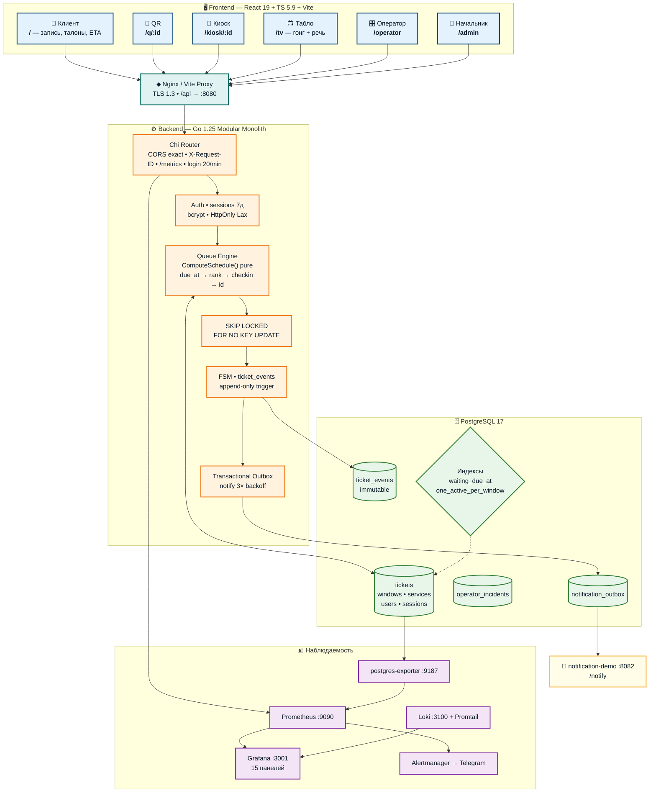
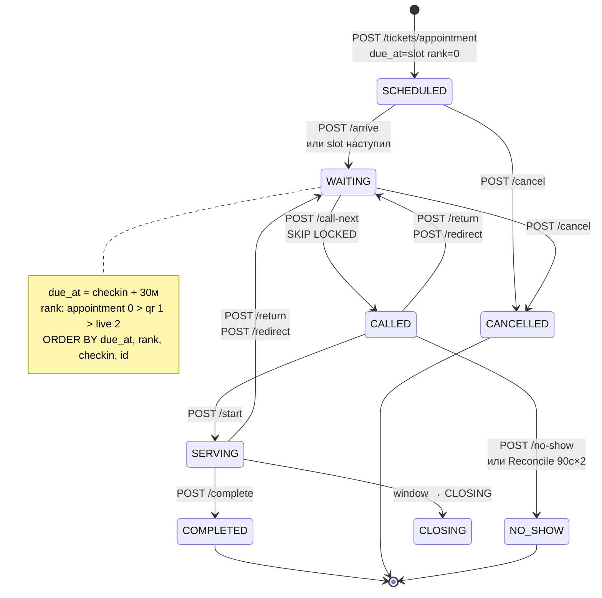
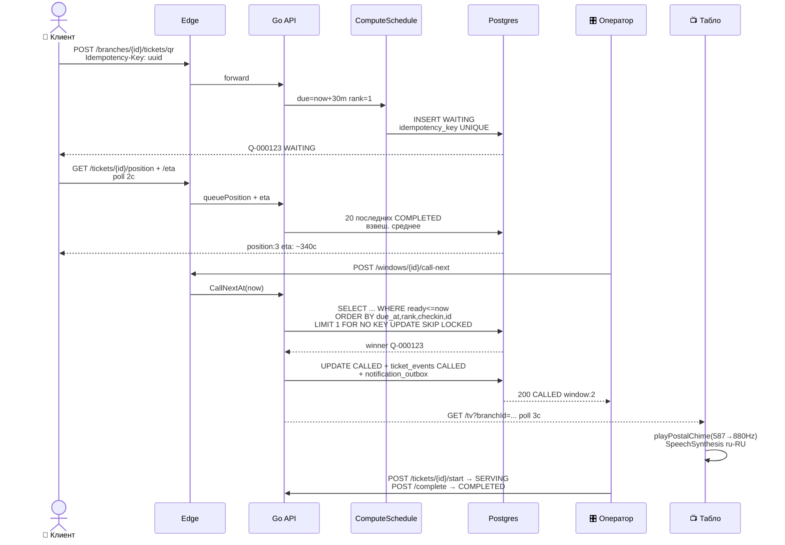

<div align="center">

# 📮 Цифровая очередь нового поколения
### Хакатон PostCode Challenge 2026 • Кейс «Электронная очередь для Почты России»
**Команда «5 указателей»**

[](https://pointers-team.tech/)
[](https://post-queue.duckdns.org/)
[](#соответствие-тз-и-сценарии-жюри)
[](docs/presentation/postcode_queue_presentation.pptx)

<br/>


<br/>

**«Меньше неопределённости. Больше времени для людей.»**
Система управления электронной очередью для почтовых отделений: предварительная запись, QR-талон со смартфона и живая очередь с единым детерминированным механизмом вызова на базе срока обслуживания (`due_at`).
Включает динамический расчет времени ожидания (ETA), гарантированную доставку уведомлений через Transactional Outbox, рабочие места оператора и начальника ОПС, а также табло зала с речевым вызовом.

---

</div>

## Содержание

1. [Быстрый запуск](#быстрый-запуск)
2. [Возможности системы](#возможности-системы)
3. [Соответствие ТЗ и сценарии жюри](#соответствие-тз-и-сценарии-жюри)
4. [Алгоритм очереди](#алгоритм-очереди)
5. [Надежность и уведомления](#надежность-и-уведомления)
6. [Архитектура системы](#архитектура-системы)
7. [API](#api)
8. [Тестирование и верификация](#тестирование-и-верификация)
9. [Российский технологический контур](#российский-технологический-контур)
10. [Масштабирование](#масштабирование)
11. [Дополнительные материалы](#дополнительные-материалы)

---

## Быстрый запуск

### Требования

* ОС: Linux, macOS, Windows с Docker и Docker Compose v2;
* Оперативная память: от 2 ГБ;
* Свободные порты хоста: 5173 (Frontend), 8080 (Backend API), 8081 (Swagger), 8082 (Notification Demo), 3001 (Grafana).

### Запуск

```bash
# 1. Клонирование репозитория и переход в директорию
git clone https://git.codenrock.com/codenrock/khakaton-postcode-challenge-ot-pochtatekha/5-ukazateley/tsifrovaya-ochered-novogo-pokoleniya.git
cd tsifrovaya-ochered-novogo-pokoleniya

# 2. Создание файла конфигурации окружения
cp .env.example .env
# отредактируйте POSTGRES_PASSWORD / GRAFANA_PASSWORD для production (см. scripts/validate_env.sh)

# 2.1 Проверка конфигурации (рекомендуется)
bash scripts/validate_env.sh

# 3. Сборка и запуск контейнеров
docker compose up --build -d

# 4. Проверка готовности ядра сервиса
curl -s http://localhost:8080/health
curl -s http://localhost:8080/ready
```

### Интерфейсы

#### Локальный запуск

* Клиентский портал: [http://localhost:5173/](http://localhost:5173/)
* Стойка входа (QR-скан): [http://localhost:5173/q/11111111-1111-1111-1111-111111111111](http://localhost:5173/q/11111111-1111-1111-1111-111111111111)
* Табло вызова зала (TV Board): [http://localhost:5173/tv?branchId=11111111-1111-1111-1111-111111111111](http://localhost:5173/tv?branchId=11111111-1111-1111-1111-111111111111)
* Пульт оператора: [http://localhost:5173/operator](http://localhost:5173/operator)
* Панель начальника ОПС: [http://localhost:5173/admin](http://localhost:5173/admin)
* Терминал зала (Kiosk): [http://localhost:5173/kiosk/11111111-1111-1111-1111-111111111111](http://localhost:5173/kiosk/11111111-1111-1111-1111-111111111111)
* Swagger UI: [http://localhost:8081](http://localhost:8081)
* Дашборд Grafana: [http://localhost:3001/grafana/](http://localhost:3001/grafana/)

#### Публичный стенд

* Клиентский портал: [https://pointers-team.tech/](https://pointers-team.tech/)
* Стойка входа (QR-скан): [https://pointers-team.tech/q/11111111-1111-1111-1111-111111111111](https://pointers-team.tech/q/11111111-1111-1111-1111-111111111111)
* Табло вызова зала (TV Board): [https://pointers-team.tech/tv?branchId=11111111-1111-1111-1111-111111111111](https://pointers-team.tech/tv?branchId=11111111-1111-1111-1111-111111111111)
* Пульт оператора: [https://pointers-team.tech/operator](https://pointers-team.tech/operator)
* Панель начальника ОПС: [https://pointers-team.tech/admin](https://pointers-team.tech/admin)
* Терминал зала (Kiosk): [https://pointers-team.tech/kiosk/11111111-1111-1111-1111-111111111111](https://pointers-team.tech/kiosk/11111111-1111-1111-1111-111111111111)
* Swagger UI: [https://pointers-team.tech:8081](https://pointers-team.tech:8081)
* Дашборд Grafana: [https://pointers-team.tech/grafana/](https://pointers-team.tech/grafana/)

### Тестовые учетные записи

> [!NOTE]
> Тестовые учетные записи приведены исключительно для локального demo-окружения и стенда хакатона. В исходном коде отсутствуют зашитые боевые учетные данные; для производственного развертывания пароли и секреты конфигурируются через переменные окружения (`.env` / Secret Manager).

| Роль | Email | Пароль | Назначение |
|---|---|---|---|
| Начальник ОПС (`opc_chief`) | `admin@pochta.local` | `admin1234` | Управление окнами, сменами, политикой весов, пользователями, аналитикой, печатью А4 |
| Оператор окна (`employee`) | `operator@pochta.local` | `operator1234` | Выбор окна, вызов следующего талона (`CallNext`), вызов по номеру, завершение, перенаправление, инциденты |
| Клиент (`client`) | *Без авторизации* | *Свободный* | Выбор услуги, запись на слот 24ч, получение талона QR/терминала, отслеживание ETA, отмена |

---

## Возможности системы

| Область | Функциональность | Описание реализации |
|---|---|---|
| Источники талонов | Предварительная запись (`APPOINTMENT`), QR-код стойки (`QR`), терминал зала (`LIVE`) | Запись на слот 24ч: талон создается в `SCHEDULED` (`due_at = scheduled_at`, `source_rank = 0`). Чекин (`/arrive`) активирует досрочный вызов в льготное окно; при наступлении слота талон доступен к вызову `CallNext` напрямую. Мобильный талон `Q-XXXXXX`, талон терминала `L-XXXXXX`. |
| Управление приемом | Бесконфликтный вызов (`CallNext`) | Назначение талона с учетом набора услуг окна (`window_services`), атомарная защита транзакцией PostgreSQL с `FOR UPDATE SKIP LOCKED`. |
| Жизненный цикл | Конечный автомат состояний (FSM) | `SCHEDULED` -> `WAITING` -> `CALLED` -> `SERVING` -> `COMPLETED` (а также прямой вызов `SCHEDULED` -> `CALLED` по наступлению времени слота). |
| Исключения и маневры | Неявка, возврат, перенаправление | Фиксация неявки (`NO_SHOW`), возврат отошедшего клиента в начало очереди (`RETURNED`), перевод талона на другую услугу или окно (`REDIRECTED`). |
| Окна и смены | Жизненный цикл окон | Смена статусов (`OPEN`, `PAUSED`, `CLOSING`, `CLOSED`), корректное завершение активного обслуживания перед закрытием окна. |
| Политика очередей | Динамический `QueuePolicy` | Настройка начальником ОПС весов источников, льготного окна и лимитов ожидания с немедленным пересчетом очереди. |
| Прогноз ожидания | Динамический ETA | Расчет оставшегося времени на базе скользящей выборки длительностей завершенных талонов с отсечением аномалий (>7200с). |
| Оповещения | Transactional Outbox | Сетевые отказы провайдера уведомлений не блокируют вызов клиента оператором; доставка выполняется асинхронно с повторными попытками. |
| Зал и табло | TV Board и синтез речи | Отображение вызванных талонов на табло с воспроизведением 2-тонального гонга и голосового вызова (Web Audio и Web Speech API). |
| Стойка отделения | Печать плаката А4 | Экран предпросмотра плаката стойки для планшетов и поддержка `@media print` с заполнением 100% листа А4 для печати на принтере. |
| Аудит и аналитика | Неизменяемый журнал и инциденты | Защита от модификации истории аудита триггером БД (`ticket_events`), регистрация операционных инцидентов (`operator_incidents`), дашборд аномалий. |
| Безопасность | Аутентификация и RBAC | Серверные сессионные куки в PostgreSQL, хеширование паролей, разграничение прав доступа по ролям (`employee`, `opc_chief`). Настройка услуг окна (`PUT /api/v1/admin/windows/{id}/services`) доступна сотрудникам отделения (`employee`, `opc_chief`) для окон отделения в рамках ролевой модели; отдельная изоляция владения конкретным окном («per-window user ownership») в архитектуре намеренно не вводилась. |

---

## Соответствие ТЗ и сценарии жюри

Все 10 обязательных сценариев ТЗ проверяются автоматизированным тестом:

```bash
python3 qa/jury_gate.py
```

| # | Сценарий ТЗ | Статус | Механизм и доказательство в репозитории |
|---|---|:---:|---|
| 1 | Appointment creation | PASS | Бронирование слота создает талон `SCHEDULED` (`due_at = scheduled_at`, `source_rank = 0`); чекин на месте переводит в `WAITING` с событием `ARRIVED`; при наступлении слота талон доступен для вызова `CallNext` напрямую. |
| 2 | Physical QR ticket | PASS | Маршрут `/q/{branchId}` разрешает отделение, клиент выбирает услугу, бэкенд возвращает талон `Q-XXXXXX` в статусе `WAITING` с `due_at = now + 30m`. |
| 3 | Free Window CallNext | PASS | Свободное окно вызывает подходящего кандидата по пересечению услуг; талон переходит в `CALLED`, окно закрепляется, событие пишется в аудит. |
| 4 | Concurrent two-Window CallNext | PASS | Два окна одновременно вызывают единственный талон. Благодаря `FOR UPDATE SKIP LOCKED` побеждает ровно 1 окно (`200 OK`), второе получает `409 NO_ELIGIBLE_TICKETS`. |
| 5 | Close active Window | PASS | При `CALLED` талон остается закреплен; при `SERVING` окно переходит в статус `CLOSING`, обслуживает текущего клиента и безопасно закрывается (`CLOSED`). |
| 6 | Redirect | PASS | Оператор перенаправляет талон на другую услугу: создается событие `REDIRECTED`, статус меняется на `WAITING`, и целевое окно успешно завершает прием. |
| 7 | Restart recovery | PASS | После полного рестарта контейнеров (`docker restart postgres backend`) активные сессии сотрудников, талоны и политики сохраняются в базе данных. |
| 8 | Notification service unavailable | PASS | Симуляция отказа внешнего шлюза (HTTP 503) не блокирует вызов оператором (`CallNext` успешен); Transactional Outbox выполняет ретраи и доставляет при восстановлении. |
| 9 | Concurrent Ticket creation | PASS | 10 параллельных запросов с одинаковым `idempotency_key` генерируют ровно 1 талон в БД (9 идемпотентных ответов без дублей). |
| 10 | Manager analytics | PASS | Начальник ОПС получает живые SQL-агрегации (ожидающие, обслуженные, среднее время, открытые окна) и зарегистрированные инциденты смены. |

---

## Алгоритм очереди

Логика распределения талонов исключает субъективность при вызове клиентов.

### Отбор кандидатов

Окно обслуживает только те талоны, услуги которых привязаны к данному окну в таблице `window_services`, находящиеся в статусе `WAITING` (либо подтвержденная запись `SCHEDULED`) и со временем готовности `ready_at <= current_timestamp`.

### Канонический вектор ранжирования

```text
ORDER BY t.due_at ASC, t.source_rank ASC, t.checkin_at ASC, t.id ASC
```

* `due_at ASC`: Защита от долгого ожидания и голодания (Aging & Wait Protection). Расчетный дедлайн обслуживания формируется с учетом порога ожидания (`anti_starvation_threshold_minutes`). По мере ожидания расчетный срок приближается, продвигая заждавшихся клиентов вперед.
* `source_rank ASC`: При совпадении дедлайнов приоритет отдается предварительной записи (`APPOINTMENT` = 0) перед стойкой входа (`QR` = 1) и терминалом (`LIVE` = 2).
* `checkin_at ASC` (Детерминированный tie-breaker по времени чекина): При равном дедлайне и ранге источника первым вызывается клиент, зарегистрировавшийся в отделении раньше.
* `id ASC` (Строгий детерминизм): Финальное устранение неоднозначности при полном совпадении временных меток.

### Конкурентность

Вызов талона выполняется SQL-запросом с конструкцией `FOR UPDATE OF t SKIP LOCKED`. Параллельные вызовы операторов разных окон мгновенно пропускают уже захваченные строки без взаимных блокировок (Deadlocks) и без риска двойного вызова.

Детальное математическое описание симуляции ETA, расчет формул и FSM талона приведены в [docs/queue-algorithm.md](docs/queue-algorithm.md).

---

## Надежность и уведомления

1. Изоляция очередей от внешних сетей: оператор не ожидает ответа внешнего шлюза. Обновление статуса талона на `CALLED` и добавление записи в таблицу `notification_outbox` происходят атомарно в единой транзакции PostgreSQL.
2. Асинхронный воркер доставки: фоновый процесс забирает накопившиеся сообщения и выполняет отправку с экспоненциальным backoff и джиттером.
3. Адаптер уведомлений: в MVP подключен локальный демонстрационный эмулятор (`notification-demo:8082`), фиксирующий отправку сообщений. Архитектурная граница изолирована: переключение на внешний шлюз SMS/Push выполняется сменой целевого URL в конфигурации `.env`.

---

## Архитектура системы

> 💡 Наведи на узел, кликни по ссылке, разверни детали ▼



<details>
<summary><b>🔍 Как читать — слой за слоем</b></summary>

| Цвет | Слой | Что внутри | Файл |
|---|---|---|---|
| <span style="color:#003B73">■</span> Синий | Frontend | Клиент/QR/Киоск/Табло/Оператор/Начальник — polling 2–5с, Moscow TZ, a11y | `frontend/src/App.tsx:14` |
| <span style="color:#00695C">■</span> Бирюза | Edge | Nginx + Vite proxy, TLS 1.3, `VITE_API_BASE_URL` | `nginx/nginx.conf`, `vite.config.ts:25` |
| <span style="color:#ED6C02">■</span> Оранж | Backend | Chi, RBAC `employee/opc_chief`, `ComputeSchedule()` pure, `SKIP LOCKED` | `internal/domain/queue_schedule.go:136`, `persistence/postgres.go:382` |
| <span style="color:#2E7D32">■</span> Зелёный | Данные | `tickets`, `windows`, `ticket_events` immutable, `notification_outbox`, `operator_incidents` | `migrations/000014`, `init.sql` |
| <span style="color:#7B1FA2">■</span> Фиолетовый | Observability | Prometheus → Grafana 15 панелей → Alertmanager Telegram, Loki+Promtail | `monitoring/*` |

Короткий поллинг — осознанно: устойчивость к обрывам без WebSocket, все переходы состояний — через БД.

</details>

### Жизненный цикл талона — интерактивно



<details>
<summary><b>🔄 Sequence — от QR до табло (кликни)</b></summary>



*Запись:* `due_at=slot`, `ready_at=slot` (до чекина), после `arrive` → `checkin`; ранний приход `checkin < slot-10м` → `due=checkin+30м rank=live` (теряет приоритет, но не талон). Опоздание `>15м` → `due=checkin+30м+penalty`.

</details>

<details>
<summary><b>📐 Формулы — due_at / ready_at / ETA</b></summary>

* **QR/LIVE:** `ready=checkin`, `due=checkin + max_wait (service 30/15м или source 30м)` — `queue_schedule.go:230`
* **Appointment вовремя `checkin ∈ [slot-10м, slot+15м]`:** `due=slot`, `ready=checkin`, `rank=0`
* **Appointment рано/поздно:** `due=checkin+30м+penalty(lateMin×penalty)`, `rank=live` — `queue_schedule.go:196`
* **ETA** `eta.go:46`: 20 последних `COMPLETED` той же `(branch,service)`, `weighted = Σ dur·(N-i)/Σ(N-i)`, свободное окно `0`, занятое `max(30, weighted-elapsed)`, раздача `position-1` на earliest-window, clamp `60..1800`.

</details>

---

## API

API системы стандартизировано по спецификации OpenAPI 3.0. Ответы возвращаются в формате JSON, операции защищены серверными сессиями и проверкой ролей.

* Интерактивный интерфейс Swagger UI: [http://localhost:8081](http://localhost:8081) (на локальном стенде) или [https://pointers-team.tech:8081](https://pointers-team.tech:8081) (на удаленном стенде).
* Спецификация OpenAPI 3.0 (47 операций, 100% паритет): [docs/openapi.yaml](docs/openapi.yaml).

### Группы маршрутов

* `/api/v1/auth` — вход, выход, регистрация и получение профиля активной сессии;
* `/api/v1/branches` — каталог отделений, услуг, загрузки зала и данных для табло;
* `/api/v1/tickets` — получение талонов (QR стойки, терминал, бронь 24ч), статус, позиция, ETA и отмена;
* `/api/v1/operator` — пульт оператора: детерминированный вызов (`call-next`), старт обслуживания, завершение, неявка (`no-show`), возврат в очередь, перенаправление и фиксация инцидентов;
* `/api/v1/admin` — кабинет начальника: управление окнами, расписаниями, сотрудниками, очередью и динамической политикой весов (`queue-policy`).

---

## Тестирование и верификация

| Контрольный рубеж | Объект проверки | Команда запуска | Результат |
|---|---|---|:---:|
| Сценарии жюри ТЗ | 10 обязательных сценариев ТЗ | `python3 qa/jury_gate.py` | PASS |
| Анализ кода Go | Статический анализ ядра Go | `cd backend && go vet ./...` | PASS |
| Модульные тесты Go | Юнит-тесты бизнес-логики и FSM | `cd backend && go test -count=1 ./...` | PASS |
| Race Detector Go | Конкурентная безопасность горутин | `cd backend && go test -race -count=1 ./...` | PASS |
| Типизация Frontend | Проверка типов TypeScript | `cd frontend && npm run typecheck` | PASS |
| Тесты Frontend | 31 компонентный и системный тест UI | `cd frontend && npm test` | PASS |
| Сборка Frontend | Продакшн-сборка интерфейсов Vite | `cd frontend && npm run build` | PASS |
| Паритет OpenAPI | Соответствие 47 эндпоинтов спецификации | `python3 qa/sprint4/openapi.py` | PASS |
| Релизный гейт | Параллельный вызов операторов | `python3 qa/sprint4/release.py` | PASS |

---

## Российский технологический контур

Решение спроектировано на базе открытого стека технологий (Self-Hosted Open-Source):

* Автономность: комплекс разворачивается локально, не требует зарубежных облачных платформ (AWS, Azure, GCP, Cloudflare) и функционирует в изолированном корпоративном контуре без внешних SaaS-сервисов.
* ОС: Linux (бинарный запуск ядра Go и PostgreSQL на российских дистрибутивах Astra Linux, РЕД ОС, ALT Linux).
* СУБД: PostgreSQL 17 (совместимо со стандартом Postgres Pro).
* Серверная часть: Go 1.25 (статически скомпилированный бинарный артефакт без сторонних runtime-зависимостей).
* Клиентская часть: React 19 + TypeScript (статический бандл, обслуживаемый локальным Nginx без внешних CDN).
* Стек наблюдаемости: Prometheus, Alertmanager, Grafana, Loki (открытый контур мониторинга и сбора логов).

---

## Масштабирование

Архитектурное предложение для филиальной сети (концепция масштабирования, не результат нагрузки MVP):

1. Изоляция по отделениям (`branch_id` Partitioning): очереди отделений независимы. Вызовы операторов и блокировки строк не пересекаются между ОПС. Таблицы `tickets`, `ticket_events` и `notification_outbox` секционируются по хешу `branch_id` на пуле шардов PostgreSQL.
2. Stateless-масштабирование бэкенда: узлы Go-бэкенда не хранят разделяемого состояния в оперативной памяти — синхронизация гарантируется базой данных. Экземпляры бэкенда масштабируются горизонтально в Kubernetes за балансировщиком нагрузки.
3. Централизованная дистрибуция политик: центральный офис управляет нормативами времени и весами очередей через версионируемый `QueuePolicy` с репликацией на отделения.
4. Асинхронная аналитика: батчевая передача агрегированных событий в аналитическое DWH через Transactional Outbox исключает просадки производительности локальных ОПС.

Подробное описание архитектурного предложения масштабирования доступно в [docs/scaling-40k.md](docs/scaling-40k.md).


PostCode Challenge 2026 • Команда «5 указателей»
