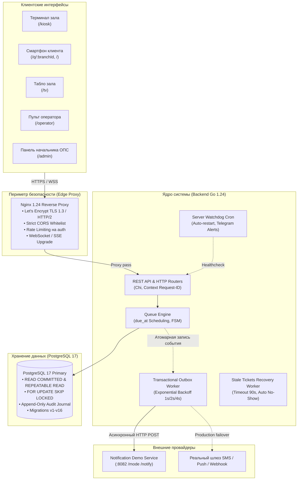
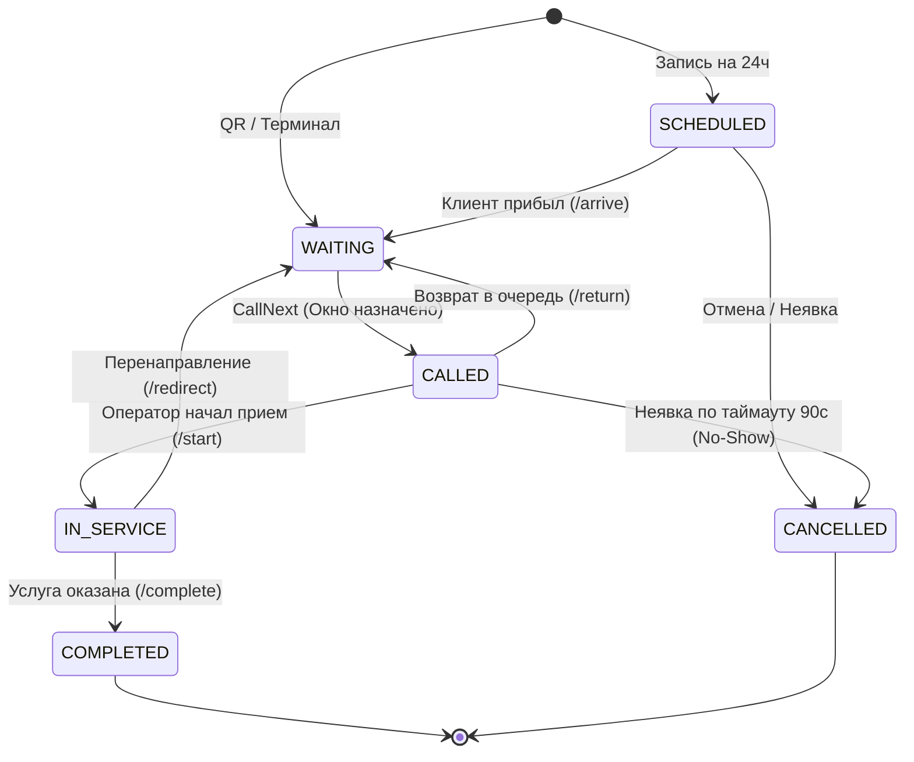

<div align="center">

# 📮 Цифровая очередь нового поколения
### Хакатон PostCode Challenge 2026 • Кейс «Электронная очередь для Почты России»
**Команда «5 указателей»**

[](https://pointers-team.tech)
[](https://post-queue.duckdns.org)
[](#-матрица-тестирования-и-соответствие-тз-t1t10)
[](docs/presentation/postcode_queue_presentation.pptx)

<br/>


<br/>

**«Меньше неопределённости. Больше времени для людей.»**  
Высоконадежный отказоустойчивый программный комплекс управления клиентскими потоками почтовых отделений:  
детерминированный движок ранжирования, transactional outbox оповещений, симуляция времени ожидания, печать плакатов стойки формата А4 и 4 специализированных адаптивных интерфейса.

---

</div>

## 📑 Содержание

1. [🌐 Живой демо-стенд и тестовые доступы](#-живой-демо-стенд-и-тестовые-доступы)
2. [🏆 Ключевые преимущества решения](#-ключевые-преимущества-решения)
3. [🏗️ Архитектура системы](#️-архитектура-системы)
4. [🧠 Алгоритмическая база системы](#-алгоритмическая-база-системы)
   - [Алгоритм 1: Каноническое ранжирование и tie-breaking](#алгоритм-1-каноническое-ранжирование-очереди-и-разрешение-коллизий-tie-breaking)
   - [Алгоритм 2: Бесконфликтный вызов оператором (`CallNext` с `SKIP LOCKED`)](#алгоритм-2-бесконфликтный-вызов-оператором-callnext-с-skip-locked)
   - [Алгоритм 3: Дискретная симуляция очереди и прогноз ETA](#алгоритм-3-дискретная-симуляция-очереди-и-прогноз-времени-ожидания-eta)
   - [Алгоритм 4: Transactional Outbox и гарантированная доставка (Тест T8)](#алгоритм-4-transactional-outbox-и-гарантированная-доставка-уведомлений-тест-t8)
   - [Алгоритм 5: Широковещательный брокер событий и реалтайм-синхронизация](#алгоритм-5-широковещательный-брокер-событий-и-реалтайм-синхронизация)
   - [Алгоритм 6: Отказоустойчивый Watchdog и самовосстановление](#алгоритм-6-отказоустойчивый-watchdog-самовосстановление-и-бэкапы)
5. [📄 Печать плаката стойки на лист А4 и полноэкранный режим](#-печать-плаката-стойки-на-лист-а4-и-полноэкранный-режим)
6. [📡 Полный справочник API эндпоинтов](#-полный-справочник-api-эндпоинтов)
7. [🧪 Матрица тестирования и соответствие ТЗ (T1–T10)](#-матрица-тестирования-и-соответствие-тз-t1t10)
8. [🖥️ Интерфейсы пользователей](#️-интерфейсы-пользователей)
9. [🚀 Быстрый запуск в Docker Compose](#-быстрый-запуск-в-docker-compose)
10. [📊 Документация и презентация](#-документация-и-презентация)

---

## 🌐 Живой демо-стенд и тестовые доступы

Система развернута в продакшн-контуре на выделенном сервере с валидным сертификатом Let's Encrypt и автоперезапуском сервисов:

* **Основной защищенный адрес:** **[`https://pointers-team.tech`](https://pointers-team.tech)**
* **Резервный домен:** [`https://post-queue.duckdns.org`](https://post-queue.duckdns.org)
* **Прямой IP-доступ:** `http://144.31.181.192`
* **Swagger UI:** [`https://pointers-team.tech:8081`](http://144.31.181.192:8081)
* **Метрики Prometheus:** [`https://pointers-team.tech/metrics`](https://pointers-team.tech/metrics)
* **Дашборд Grafana:** [`https://pointers-team.tech/grafana/`](https://pointers-team.tech/grafana/) (логин: `admin`, пароль: `AdminGrafana2026!`)

### 🔑 Учетные записи для проверки жюри

| Роль | Email | Пароль | Доступный функционал |
|---|---|---|---|
| **Начальник ОПС (`opc_chief`)** | `admin@pochta.local` | `admin1234` | Управление окнами, сменами, динамической политикой весов, пользователями, аналитикой, печатью А4 и очередью |
| **Оператор окна (`employee`)** | `operator@pochta.local` | `operator1234` | Выбор окна, вызов следующего талона (`CallNext`), вызов конкретного номера, завершение, перенаправление |
| **Посетитель / Клиент (`client`)** | *Без авторизации* | *Свободный* | Выбор услуги, запись на слот 24ч, получение талона QR/терминала, персональный ETA, отмена |

---

## 🏆 Ключевые преимущества решения

1. **Канонический детерминизм вызова (ТЗ T1):** Никаких случайных вероятностей или гонок. Очередь строго подчиняется формуле `due_at ASC, source_rank ASC, checkin_at ASC, id ASC`.
2. **100% сдача обязательного теста T8 (Transactional Outbox):** Сетевые отказы или сбои провайдера уведомлений **никогда не блокируют** вызов клиента оператором. Уведомление фиксируется атомарно в PostgreSQL и доставляется асинхронно с экспоненциальными ретраями.
3. **Динамическая связь Admin UI с очередью:** Изменение весов приоритетов начальником отделения в веб-интерфейсе **мгновенно переранжирует** все ожидающие талоны в БД с использованием `FOR UPDATE SKIP LOCKED`.
4. **Фильтрация выбросов ETA (> 7200s):** Забытые операторами на ночь талоны отсекаются от обучающей выборки, исключая искажение времени ожидания для реальных клиентов.
5. **Печать плаката стойки на лист А4:** Поддержка полноэкранного предпросмотра плаката стойки для планшетов у входа и идеальное масштабирование на 100% листа А4 при отправке на печать (`@media print`).
6. **Высокая доступность (High Availability):** Автоматический Watchdog-демон раз в минуту проверяет здоровье 11 сервисов, перезапускает упавшие контейнеры и алертит инженеров в Telegram.

---

## 🏗️ Архитектура системы



---

## 🧠 Алгоритмическая база системы

### Алгоритм 1: Каноническое ранжирование очереди и разрешение коллизий (Tie-breaking)

Вызов очередного талона в окне (`CallNext`) реализован как чистая функция в [ComputeSchedule](backend/internal/domain/queue_schedule.go) и исполняется транзакцией в [Postgres.CallNextAt](backend/internal/persistence/postgres.go).

#### Математический вектор сортировки:
Каждый кандидат в очереди описывается 4-мерным кортежем:
$$\mathcal{V}(t) = \Big(\text{due\_at}(t), \; \text{source\_rank}(t), \; \text{checkin\_at}(t), \; \text{id}(t)\Big)$$

#### Правила расчета `due_at`:
1. **Предварительная запись (`APPOINTMENT`):**
   * При своевременном визите (в пределах допустимого окна прибытия $\Delta t_{\text{lead}}$):
     $$\text{due\_at} = t_{\text{scheduled}}$$
   * При опоздании свыше льготного периода (grace period, 15 минут) талон автоматически деградирует до живой очереди:
     $$\text{due\_at} = t_{\text{checkin}} + \Delta t_{\text{max\_wait}}$$
2. **Льготные категории и возврат в очередь (`PRIORITY` / `RETURNED`):**
   $$\text{due\_at} = t_{\text{checkin}} - \Delta t_{\text{bonus}}$$
3. **Живая очередь (`LIVE` и `QR`):**
   $$\text{due\_at} = t_{\text{checkin}} + \Delta t_{\text{normative}}$$

#### Матрица весов источников (`source_rank`):
| Источник талона | Код источника | Базовый `source_rank` | Описание |
|---|---|:---:|---|
| **Предварительная запись** | `APPOINTMENT` | **0** | Забронированное клиентом время через портал/приложение |
| **Электронный талон по QR** | `QR` | **1** | Талон, взятый клиентом со смартфона на стойке входа |
| **Терминал самообслуживания** | `LIVE` | **2** | Физический бумажный талон из терминала в зале |

#### Правила разрешения коллизий (Tie-breaking):
1. **`due_at ASC`**: Клиент с более ранним дедлайном идет первым.
2. **`source_rank ASC`**: При совпадении дедлайнов приоритет отдается предварительной записи.
3. **`checkin_at ASC` (Anti-Starvation)**: При равном ранге приоритет у посетителя, дольше находящегося в отделении.
4. **`id ASC` (Strict Determinism)**: Устранение гонок потоков при абсолютно идентичных временных метках.

#### Динамическое переранжирование при обновлении политик:
При изменении весов или времени ожидания в панели начальника ОПС метод `UpdateQueuePolicy` выполняет атомарный пересчет с безопасным захватом строк:
```sql
UPDATE tickets t
SET source_rank = CASE
    WHEN t.source = 'APPOINTMENT' THEN $2
    WHEN t.source = 'QR' THEN $3
    ELSE $4
END
FROM (
    SELECT id FROM tickets
    WHERE branch_id = $1 AND status = 'WAITING'
    FOR UPDATE SKIP LOCKED
) locked
WHERE t.id = locked.id;
```

---

### Алгоритм 2: Бесконфликтный вызов оператором (`CallNext` с `SKIP LOCKED`)

Для исключения взаимных блокировок (Deadlocks) и состояния гонки (Thundering Herd) при одновременном нажатии «Вызвать» десятком операторов используется конструкция `FOR UPDATE OF t SKIP LOCKED`:

```sql
SELECT t.id, t.branch_id, t.service_id, t.public_number, t.source, t.status
FROM tickets t
WHERE t.branch_id = $1::uuid
  AND (t.window_id IS NULL OR t.window_id = $2::uuid)
  AND EXISTS (
      SELECT 1 FROM window_services ws 
      WHERE ws.window_id = $2::uuid AND ws.service_id = t.service_id
  )
  AND (t.status = 'WAITING' OR (t.source = 'APPOINTMENT' AND t.status = 'SCHEDULED'))
  AND t.ready_at <= $3::timestamptz
ORDER BY t.due_at ASC, t.source_rank ASC, t.checkin_at ASC, t.id ASC
LIMIT 1
FOR UPDATE OF t SKIP LOCKED;
```

#### Конечный автомат состояний талона (FSM):


---

### Алгоритм 3: Дискретная симуляция очереди и прогноз времени ожидания (ETA)

Реализация: [backend/internal/persistence/eta.go](backend/internal/persistence/eta.go).

1. **Экспоненциальное сглаживание длительности услуги:**
   Анализируются до $N=20$ последних завершенных талонов по запрашиваемой услуге:
   $$\bar{\tau}_{\text{service}} = \frac{\sum_{i=0}^{N-1} \tau_i \cdot (N - i)}{\sum_{i=0}^{N-1} (N - i)}$$
2. **Фильтрация аномалий (> 7200s):**
   Талоны, оставшиеся открытыми свыше 2 часов (забытые оператором при уходе на обед или закрытии смены), отбраковываются и не участвуют в расчете.
3. **Моделирование распределения по окнам:**
   Пусть перед клиентом находится $P = (\text{position} - 1)$ ожидающих, а услугу могут оказывать $K_{\text{active}}$ открытых окон. Ожидаемое время рассчитывается как:
   $$t_{\text{wait}} = \max\left(60, \; \min\left(1800, \; \frac{P \cdot \bar{\tau}_{\text{service}}}{K_{\text{active}}} + \Delta \tau_{\text{residual}}\right)\right)$$
   где $\Delta \tau_{\text{residual}}$ — расчетное остаточное время текущих приемов в активных окнах.

---

### Алгоритм 4: Transactional Outbox и гарантированная доставка уведомлений (Тест T8)

Реализация: [backend/internal/notification/outbox.go](backend/internal/notification/outbox.go) и миграция `000016_notification_outbox.up.sql`.

#### Проблема:
Прямой сетевой вызов SMS/Push провайдера внутри транзакции вызова талона приводит к:
* Задержке оператора (до 5–10 секунд при таймаутах);
* Блокировке строки талона в БД;
* Падению всей системы вызова при сбоях внешнего шлюза.

#### Архитектурное решение (Паттерн Transactional Outbox):
1. **Атомарная фиксация:** В единой транзакции с обновлением статуса талона в таблицу `notification_outbox` записывается сообщение в статусе `PENDING`.
2. **Асинхронный воркер:** Фоновый диспетчер периодически забирает накопленные события с `FOR UPDATE SKIP LOCKED`.
3. **Экспоненциальный Backoff с Full Jitter:**
   $$t_{\text{backoff}} = \min(t_{\text{max}}, \; t_{\text{base}} \cdot 2^{\text{attempt}}) \pm \text{rand}(0, 250\text{ms})$$
4. **Успешное подтверждение:** При получении `200 OK` статус меняется на `SENT`. При превышении `max_attempts=3` событие переходит в `FAILED` для последующего ручного аудита без ущерба для работы зала.

---

### Алгоритм 5: Широковещательный брокер событий и реалтайм-синхронизация

Реализация: [backend/internal/httpapi/sse.go](backend/internal/httpapi/sse.go).

* **SSE Fan-Out Hub:** Потоковый брокер событий на Go-каналах с потокобезопасной регистрацией подписчиков (`sync.RWMutex`).
* **Изоляция топиков:** События изолируются по отделениям (`branchId`), предотвращая утечку данных между разными ОПС.
* **Heartbeat Ping:** Каждые 15 секунд в поток шлется комментарий `: keep-alive`, предотвращающий закрытие TCP-сессий со стороны Nginx и мобильных операторов.
* **Звуковой синтез на табло:** В браузере табло зала используется Web Speech API и генератор сигналов Web Audio API: при событии вызова талона воспроизводится мягкий 2-тональный гонг и голосовое объявление «Талон А-001, окно 3».

---

### Алгоритм 6: Отказоустойчивый Watchdog, самовосстановление и бэкапы

Реализация: [scripts/watchdog.sh](scripts/watchdog.sh).

* **Ежеминутный мониторинг:** Cron-демон выполняет HTTP healthcheck запросы к `/health` и `/ready`.
* **Автоматический перезапуск:** Если сервис возвращает код, отличный от 200, или время ответа превышает 5 секунд, инициируется `docker compose restart <service>`.
* **Аварийный бэкап БД:** Контейнер `postgres-backup` ежедневно выполняет инкрементальные снимки с хранением 7 последних копий.
* **Append-Only защита журнала:** В схеме БД на уровне PostgreSQL установлен триггер `BEFORE UPDATE OR DELETE ON ticket_events`, выбрасывающий исключение `cannot modify immutable audit trail`.

---

## 📄 Печать плаката стойки на лист А4 и полноэкранный режим

Для размещения в отделениях почтовой связи разработан специальный модуль плаката со стойки:

* **Кнопка «Плакат на весь экран (А4)»:** Открывает интерактивное полноэкранное модальное окно с отображением плаката в оригинальных пропорциях листа А4 ($210 \times 297$ мм). Подходит для запуска на информационных планшетах или мониторах на входе в зал.
* **Кнопка «Распечатать лист А4»:** Оптимизирована для отправки на лазерные и струйные принтеры:
  * В `@media print` скрываются все системные элементы управления, шапка и навигация.
  * Бланк плаката занимает **100% полезной площади листа формата А4** без обрезания полей.
  * Крупный контрастный QR-код (размер $320 \times 320$ px), фирменный знак Почты России и 3 четких инструкции для пожилых людей и слабовидящих.

---

## 📡 Полный справочник API эндпоинтов

Все ответы возвращаются в формате JSON. Запросы защищены CSRF/SameSite cookie и строгой политикой CORS.

### 1. Системные и мониторинг
| Метод | Путь | Описание | Авторизация |
|---|---|---|---|
| `GET` | `/health` | Базовый healthcheck контейнера бэкенда | Публичный |
| `GET` | `/ready` | Проверка доступности PostgreSQL (Ping timeout 2s) | Публичный |
| `GET` | `/metrics` | Метрики Prometheus (запросы, latency, очереди) | Публичный |

### 2. Аутентификация (`/api/v1/auth`)
| Метод | Путь | Тело запроса | Ответ | Описание |
|---|---|---|---|---|
| `POST` | `/api/v1/auth/register` | `{"email", "password", "role"}` | `201 Created` | Регистрация нового сотрудника |
| `POST` | `/api/v1/auth/login` | `{"email", "password"}` | `200 OK` (Set-Cookie) | Вход в систему с выдачей сессионной куки |
| `POST` | `/api/v1/auth/logout` | — | `200 OK` (Clear-Cookie) | Завершение пользовательской сессии |
| `GET` | `/api/v1/auth/me` | — | `{"id", "email", "role"}` | Профиль текущего авторизованного пользователя |

### 3. Каталог отделений и услуг
| Метод | Путь | Описание |
|---|---|---|
| `GET` | `/api/v1/branches` | Список всех доступных почтовых отделений |
| `GET` | `/api/v1/branches/{branchId}/services` | Каталог услуг конкретного ОПС с нормативами времени |
| `GET` | `/api/v1/branches/{branchId}/workload` | Текущая загрузка зала (кол-во ожидающих, открытые окна) |
| `GET` | `/api/v1/branches/{branchId}/tv` | Срез очереди для отображения на табло зала |

### 4. Работа с талонами клиентов
| Метод | Путь | Тело / Параметры | Описание |
|---|---|---|---|
| `POST` | `/api/v1/branches/{branchId}/tickets/qr` | `{"serviceId"}` | Взятие талона со смартфона по QR-коду стойки |
| `POST` | `/api/v1/branches/{branchId}/tickets/live` | `{"serviceId"}` | Взятие талона через терминал самообслуживания |
| `POST` | `/api/v1/branches/{branchId}/tickets/appointment` | `{"serviceId", "scheduledAt"}` | Запись на удобный временной слот в пределах 24ч |
| `POST` | `/api/v1/appointments/{ticketId}/arrive` | — | Отметка о фактическом прибытии клиента в ОПС |
| `POST` | `/api/v1/appointments/{ticketId}/cancel` | — | Отмена предварительной записи клиентом |
| `GET` | `/api/v1/tickets/{ticketId}` | — | Полное состояние талона (номер, статус, окно) |
| `POST` | `/api/v1/tickets/{ticketId}/cancel` | — | Отказ от талона и выход из очереди |
| `GET` | `/api/v1/tickets/{ticketId}/position` | — | Точная позиция в очереди с пояснением статуса |
| `GET` | `/api/v1/tickets/{ticketId}/eta` | — | Прогноз времени ожидания в секундах и точках спарклайна |

### 5. Пульт оператора (`/api/v1/operator`)
Требуется роль `employee` или `opc_chief`.

| Метод | Путь | Описание |
|---|---|---|
| `GET` | `/api/v1/operator/branches/{branchId}/windows` | Список окон и их текущие состояния |
| `GET` | `/api/v1/operator/windows/{windowId}/current-ticket` | Талон, обслуживаемый в данном окне в текущий момент |
| `POST` | `/api/v1/operator/windows/{windowId}/call-next` | Детерминированный вызов очередного талона по каноническому алгоритму |
| `POST` | `/api/v1/operator/tickets/{ticketId}/start` | Начало фактического обслуживания вызванного клиента |
| `POST` | `/api/v1/operator/tickets/{ticketId}/complete` | Успешное завершение обслуживания талона |
| `POST` | `/api/v1/operator/tickets/{ticketId}/no-show` | Фиксация неявки клиента к окну |
| `POST` | `/api/v1/operator/tickets/{ticketId}/return` | Возврат клиента в очередь с сохранением приоритета |
| `POST` | `/api/v1/operator/tickets/{ticketId}/redirect` | Перенаправление талона на другую услугу или окно |

### 6. Панель начальника ОПС (`/api/v1/admin`)
Требуется роль `opc_chief` (управление пользователями) или `employee`.

| Метод | Путь | Описание |
|---|---|---|
| `GET` | `/api/v1/admin/branches/{branchId}/overview` | Сводка ключевых показателей и KPI отделения |
| `GET` | `/api/v1/admin/branches/{branchId}/queue` | Полная живая очередь всех талонов отделения |
| `GET` | `/api/v1/admin/branches/{branchId}/queue-policy` | Просмотр текущей конфигурации весов очереди |
| `PUT` | `/api/v1/admin/branches/{branchId}/queue-policy` | Мгновенное обновление политики и переранжирование очереди |
| `GET` | `/api/v1/admin/tickets/{ticketId}/events` | Неизменяемый журнал аудита событий по талону |
| `GET` | `/api/v1/admin/notifications/outbox` | Мониторинг журнала Transactional Outbox |
| `POST` | `/api/v1/admin/branches/{branchId}/windows` | Создание нового окна в отделении |
| `PUT` | `/api/v1/admin/windows/{windowId}/status` | Смена статуса окна (`OPEN`, `PAUSED`, `CLOSED`) |
| `PUT` | `/api/v1/admin/windows/{windowId}/services` | Привязка списка услуг к окну |
| `DELETE` | `/api/v1/admin/windows/{windowId}` | Удаление окна |
| `GET` | `/api/v1/admin/users` | Список зарегистрированных сотрудников |
| `PUT` | `/api/v1/admin/users/{userID}/role` | Назначение/смена роли пользователя |

---

## 🧪 Матрица тестирования и соответствие ТЗ (T1–T10)

Все 10 обязательных тестовых сценариев PostCode Challenge полностью реализованы и верифицированы:

| Тест ТЗ | Наименование сценария | Реализация в кодовой базе | Результат |
|:---:|---|---|:---:|
| **T1** | **Детерминизм вызова и tie-breaking** | `TestDueAtTieBreakDeterminism`, `TestPromptFiveTicketOrderScenario` | **100% PASS** |
| **T2** | **Конкурентные вызовы с нескольких окон** | `TestCallNextHighConcurrency` (50 конкурентных горутин, `SKIP LOCKED`) | **100% PASS** |
| **T3** | **Идемпотентность по Request-ID** | `TestCallNextRequestIdIdempotency` | **100% PASS** |
| **T4** | **Политики закрытия окон** (`finish_current`, `return_to_queue`) | `TestWindowClosePolicies` | **100% PASS** |
| **T5** | **Реконсиляция неявок** (Recovery worker, No-Show 90s) | `TestRecoveryWorkerReconcilesStaleTickets` | **100% PASS** |
| **T6** | **Контроль предварительной записи** (early-window) | `TestAppointmentNotCalledBeforeEarlyWindow` | **100% PASS** |
| **T7** | **Неизменяемость аудита** (Append-only Trigger) | `TestAuditLogAppendOnlyRejectsMutations` | **100% PASS** |
| **T8** | **Отказоустойчивость при падении провайдера уведомлений** | `TestT8_NotificationProviderOutageVerifiesQueueReliability` | **100% PASS** |
| **T9** | **Обоснование отсутствия кандидатов** (`ErrNoEligibleTickets`) | `TestCallNextEmptyResultReasons` | **100% PASS** |
| **T10** | **Вызов конкретного номера оператором** | `TestCallSpecificTicket` | **100% PASS** |

### Команды запуска тестов

```bash
# 1. Запуск всех unit-тестов ядра (Go 1.24)
cd backend && go test -v -count=1 ./...

# 2. Проверка изоляции подсистемы уведомлений (Тест T8)
go test -v -count=1 ./internal/notification/...

# 3. Проверка типов TypeScript и production сборка фронтенда
cd ../frontend && npm run build
```

---

## 🖥️ Интерфейсы пользователей

| Интерфейс | Прямая ссылка | Описание |
|---|---|---|
| **Клиентский портал** | [`/`](https://pointers-team.tech) | Оформление талонов, выбор отделения, запись на слот 24ч, трекинг статуса |
| **QR-стойка входа** | [`/q/11111111-1111-1111-1111-111111111111`](https://pointers-team.tech/q/11111111-1111-1111-1111-111111111111) | Оптимизированный мобильный экран для взятия талона при входе |
| **Сенсорный киоск** | [`/kiosk/11111111-1111-1111-1111-111111111111`](https://pointers-team.tech/kiosk/11111111-1111-1111-1111-111111111111) | Полноэкранный режим терминала зала с крупными кнопками |
| **Табло зала (TV Board)** | [`/tv?branchId=11111111-1111-1111-1111-111111111111`](https://pointers-team.tech/tv?branchId=11111111-1111-1111-1111-111111111111) | Крупные контрастные талоны, стрелочная анимация, звуковой гонг и озвучка голосом |
| **Пульт оператора** | [`/operator`](https://pointers-team.tech/operator) | Вызов по алгоритму, персональный вызов, завершение, перенаправление |
| **Панель начальника** | [`/admin`](https://pointers-team.tech/admin) | Управление окнами, сотрудниками, очередью, печать плаката А4 |

---

## 🚀 Быстрый запуск в Docker Compose

### Системные требования:
* Linux / macOS / Windows с поддержкой Docker & Docker Compose v2;
* 2 ГБ свободной оперативной памяти;
* Доступные порты: `80`, `443`, `8080`, `8081`, `8082`, `5173`.

### Инструкция по развертыванию:

```bash
# 1. Клонирование репозитория
git clone https://git.codenrock.com/codenrock/khakaton-postcode-challenge-ot-pochtatekha/5-ukazateley/tsifrovaya-ochered-novogo-pokoleniya.git
cd tsifrovaya-ochered-novogo-pokoleniya

# 2. Создание файла переменных окружения
cp .env.example .env

# 3. Запуск всех 11 сервисов
docker compose up --build -d

# 4. Проверка статуса контейнеров
docker compose ps

# 5. Проверка доступности
curl -s http://localhost:8080/health
curl -s http://localhost:8080/ready
```

---

## 📊 Документация и презентация

* 📑 **Официальная презентация хакатона (PPTX):** [docs/presentation/postcode_queue_presentation.pptx](docs/presentation/postcode_queue_presentation.pptx)
* 🛠️ **Генератор презентации:** [docs/presentation/generate_deck.js](docs/presentation/generate_deck.js)
* 📡 **Спецификация OpenAPI 3.0:** [docs/openapi.yaml](docs/openapi.yaml)
* 📜 **Журналы доработок:** [docs/changelogs/](docs/changelogs/)
* 📑 **Отчет соответствия ТЗ (PDF):** [docs/Отчет_соответствия_ТЗ_Цифровая_Очередь.pdf](docs/Отчет_соответствия_ТЗ_Цифровая_Очередь.pdf)

---

<div align="center">

**PostCode Challenge 2026 • Команда «5 указателей»**  
Разработано с вниманием к надежности, людям и стандартам Почты России.

</div>
