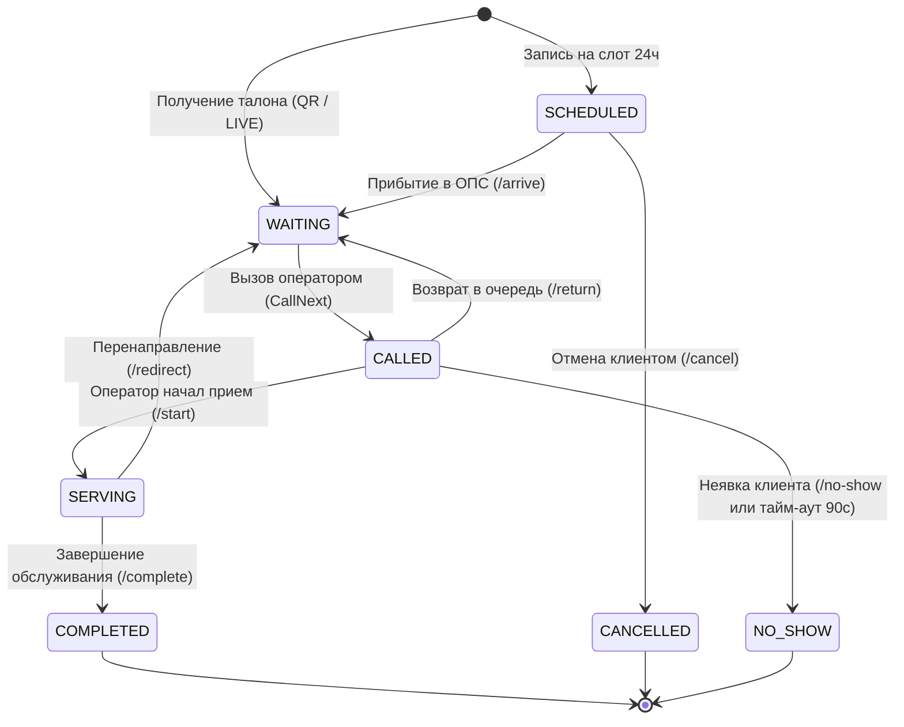

# Математическое и техническое описание алгоритмической базы очереди

В данном документе приведено детальное описание математического аппарата, конечного автомата состояний и реализации алгоритмов цифровой очереди.

---

## 1. Каноническое ранжирование очереди и разрешение коллизий (Tie-breaking)

Вызов очередного талона в окне (`CallNext`) реализован как чистая функция в [`backend/internal/domain/queue_schedule.go`](../backend/internal/domain/queue_schedule.go) и исполняется в рамках транзакции PostgreSQL в [`backend/internal/persistence/postgres.go`](../backend/internal/persistence/postgres.go).

### Математический вектор сортировки
Каждый кандидат в очереди описывается 4-мерным кортежем:
$$\mathcal{V}(t) = \Big(\text{due\_at}(t), \; \text{source\_rank}(t), \; \text{checkin\_at}(t), \; \text{id}(t)\Big)$$

### Правила расчета целевого времени (`due_at`)
1. **Предварительная запись (`APPOINTMENT`):**
   * При своевременном визите (в пределах допустимого окна прибытия $\Delta t_{\text{lead}}$):
     $$\text{due\_at} = t_{\text{scheduled}}$$
   * При опоздании свыше льготного периода (grace period, 15 минут) талон деградирует до живой очереди:
     $$\text{due\_at} = t_{\text{checkin}} + \Delta t_{\text{max\_wait}}$$
2. **Льготные категории и возврат в очередь (`PRIORITY` / `RETURNED`):**
   $$\text{due\_at} = t_{\text{checkin}} - \Delta t_{\text{bonus}}$$
3. **Живая очередь (`LIVE` и `QR`):**
   $$\text{due\_at} = t_{\text{checkin}} + \Delta t_{\text{normative}}$$

### Матрица весов источников (`source_rank`)
| Источник талона | Код источника | Базовый `source_rank` | Описание |
|---|---|:---:|---|
| **Предварительная запись** | `APPOINTMENT` | **0** | Забронированное клиентом время через портал/приложение |
| **Электронный талон по QR** | `QR` | **1** | Талон, полученный клиентом со смартфона на стойке входа |
| **Терминал самообслуживания** | `LIVE` | **2** | Физический талон из терминала в зале |

### Правила разрешения коллизий (Tie-breaking):
1. **`due_at ASC`**: Клиент с более ранним дедлайном идет первым.
2. **`source_rank ASC`**: При совпадении дедлайнов приоритет отдается предварительной записи.
3. **`checkin_at ASC` (Anti-Starvation)**: При равном ранге приоритет у посетителя, дольше находящегося в отделении.
4. **`id ASC` (Strict Determinism)**: Устранение неопределенности при совпадении меток времени.

### Реализация выбора кандидата с защитой от гонок:
```sql
SELECT t.id, t.branch_id, t.service_id, t.public_number, t.source, t.status
FROM tickets t
WHERE t.branch_id = $1::uuid
  AND (t.window_id IS NULL OR t.window_id = $2::uuid)
  AND EXISTS (
      SELECT 1 FROM window_services ws 
      WHERE ws.window_id = $2::uuid AND ws.service_id = t.service_id
  )
  AND (t.status = 'WAITING' OR (t.source = 'APPOINTMENT' AND t.status = 'SCHEDULED'))
  AND t.ready_at <= $3::timestamptz
ORDER BY t.due_at ASC, t.source_rank ASC, t.checkin_at ASC, t.id ASC
LIMIT 1
FOR UPDATE OF t SKIP LOCKED;
```

---

## 2. Конечный автомат состояний талона (FSM)



---

## 3. Дискретная симуляция очереди и расчет времени ожидания (ETA)

Реализация: [`backend/internal/persistence/eta.go`](../backend/internal/persistence/eta.go).

1. **Экспоненциальное сглаживание длительности услуги:**
   Анализируются до $N=20$ последних завершенных талонов по конкретной услуге:
   $$\bar{\tau}_{\text{service}} = \frac{\sum_{i=0}^{N-1} \tau_i \cdot (N - i)}{\sum_{i=0}^{N-1} (N - i)}$$
2. **Фильтрация выбросов (> 7200s):**
   Талоны с длительностью свыше 2 часов отсекаются от выборки, исключая искажение времени ожидания забытыми операторами талонами.
3. **Моделирование доступности окон:**
   Для открытых совместимых окон рассчитывается остаточное время текущего обслуживания $\Delta \tau_{\text{residual}}$, после чего прогнозируется время продвижения очереди до позиции клиента $P$.

---

## 4. Паттерн Transactional Outbox

Реализация: [`backend/internal/notification/outbox.go`](../backend/internal/notification/outbox.go) и миграция `000016_notification_outbox.up.sql`.

1. **Атомарная запись:** Обновление статуса талона и создание записи в `notification_outbox` выполняются в единой транзакции PostgreSQL.
2. **Асинхронная доставка:** Фоновый воркер забирает пачки сообщений с блокировкой `FOR UPDATE SKIP LOCKED`.
3. **Экспоненциальный Backoff с джиттером:**
   $$t_{\text{backoff}} = \min(t_{\text{max}}, \; t_{\text{base}} \cdot 2^{\text{attempt}}) \pm \text{rand}(0, 250\text{ms})$$
4. **Изоляция сбоев:** Сбой провайдера уведомлений (тайм-аут, HTTP 503) не откатывает операцию вызова клиента в зале.
